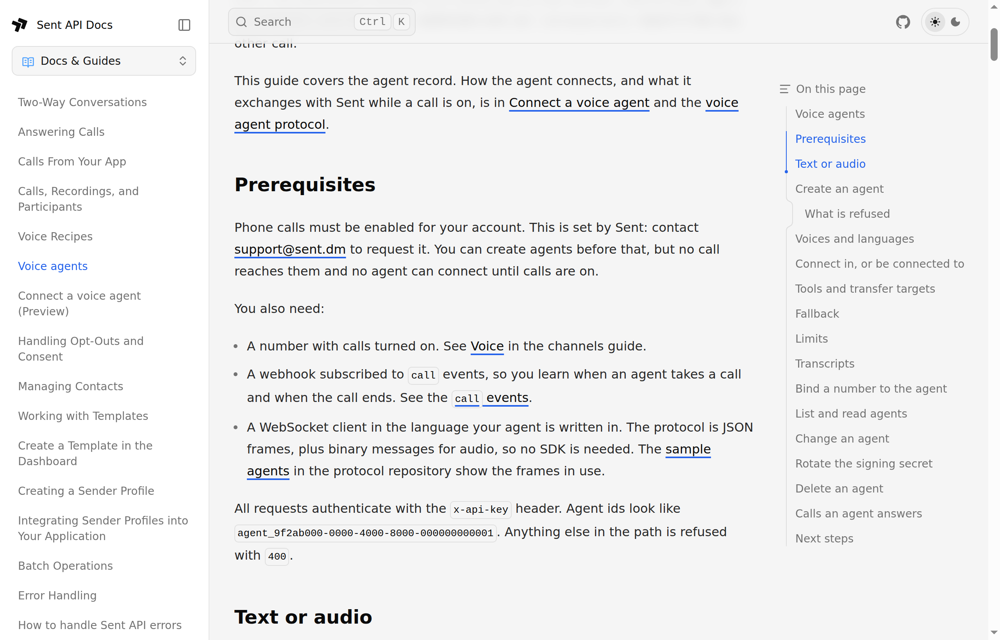

It is 6:40 in the evening and the phone at a small dental clinic is ringing.
The front desk went home at six. The caller wants to move Thursday's 9 AM
appointment because something came up at work. She gets voicemail, doesn't
leave a message, and on Thursday the chair sits empty.

Nobody did anything wrong. The call was too small to staff and too annoying
to automate with a phone menu. I think that call is the best first job
for a voice agent: it is narrow, it repeats all day, and right now it costs
someone a no-show.

So I built one. Disclosure first: I run engineering at
[Sent](https://sent.dm), and our team just shipped voice agents to production.
Read this as an insider's walkthrough, not a neutral review.

## Who does what

A Sent voice agent is a program you run. Sent owns the phone number, turns the
caller's speech into text, speaks your replies in a voice you pick, and carries
out what your agent asks for on the call: transfer, hold, keypad tones, hang
up. It also writes the call record and bills it.

Your agent holds one WebSocket. In a text session, which is what I used, it
receives each thing the caller says as a `user.said` frame and answers with
`agent.say`. No speech stack on my side, no audio, no telephony. Text in, text
out, which means the brain can be any model or plain code.

One call, every frame that crosses the socket:

```text
Sent                                            my agent
 |-- session.start  who is calling -------------->|  find their appointment
 |-- user.said      "I can't make Thursday" ----->|  ask the model
 |<-- agent.say     "I have Friday at 8 or 11:30"-|
 |-- user.said      "Friday at eight works" ----->|  move it, send the text
 |<-- agent.say     "Done. Texting you the time."-|
 |<-- tool.call     hangup -----------------------|
 |-- tool.result    ok -------------------------->|
 |-- session.end    agent_hung_up --------------->|
```

That split is the reason the whole thing fits in one file.

## The job, and nothing else

It can do three things:

1. Move the caller's next appointment to an open slot.
2. Put the caller through to the dentist on call when they describe an
   emergency: severe pain, swelling, bleeding, a knocked-out tooth.
3. End the call politely.

Everything else gets "the front desk opens at 8 AM." When an appointment moves,
the caller gets a text with the new time. That text matters more than it
looks: a phone call leaves no trace, and the receipt is what makes the
caller trust a robot with their Thursday.

Three verbs is deliberate. An agent with a short list of actions is one you can
reason about at 11 PM without being in the room.

## Step 1: get Voice turned on

Phone calls are switched on per account by Sent. Today that means writing to
[support@sent.dm](mailto:support@sent.dm), or using **Help** at the bottom of
the dashboard sidebar. The docs say the same under Prerequisites:



Say what you are building, which number you want to use, and roughly how many
calls a day to expect.

Two things to have ready: your account onboarding must be finished before the
dashboard lets you request a number, and voice numbers are US local numbers
today.

## Step 2: describe the agent

An agent is a record on your account. Everything but the name and session type
has a default, so the body is the list of decisions:

```bash
curl -X POST https://api.sent.dm/v3/voice/agents \
  -H "x-api-key: $SENT_API_KEY" -H "Content-Type: application/json" \
  -d @agent.json
```

```json
{
  "name": "Front desk, after hours",
  "session_type": "text",
  "greeting": "Thanks for calling Northside Dental. The front desk is closed, but I can move an appointment or reach the dentist on call. How can I help?",
  "tools": ["transfer", "hangup"],
  "transfer_targets": [{ "kind": "number", "value": "+12125550177" }],
  "fallback": { "kind": "number", "value": "+12125550177" },
  "limits": { "max_call_seconds": 600, "max_concurrent_calls": 5 }
}
```

What each line decides:

- **`session_type` text.** Sent does the listening and the speaking.
- **No `websocket_url`.** The agent dials in: your process connects to Sent
  with an API key and holds the connection. Set one and Sent connects to you
  for every call instead.
- **`greeting`.** Sent speaks this the moment the call is answered, so the
  caller hears something before your code has done any work.
- **`tools`: transfer and hangup.** Not hold, not DTMF. Whatever the model
  imagines, the platform refuses any tool not on this list.
- **`transfer_targets`.** The on-call dentist's mobile.
- **`fallback`.** The same mobile. If your process is down, calls go there
  instead of failing.
- **`limits`.** Moving an appointment is not a 20-minute conversation, and
  five calls at once is plenty for one clinic.
- **Voice and language left out.** Emma, US English.

The response is the agent with its id and, once only, its signing secret. A
dial-in agent doesn't use the secret, but store it anyway: give the agent a
WebSocket URL later and that is what Sent signs the handshake with.


The dashboard shows the same record. Its create dialog asks for the name,
session type, URL, voice, language and greeting; tools, targets, fallback and
limits live on the agent's page once it exists. The **Connection** card there
says **Dials in** and shows the connect URL and the agent id, which are the
two things the code needs.


## Step 3: a number that takes calls

Once Voice is on, **Channels** grows a **Voice** tab, and **Request voice
number** offers two choices: turn on calls for a US number you already hold,
or get a new one.


I used the number my sender profile already texts from. It is one request, and
it takes the agent id, so the number is bound as it is created:

```bash
curl -X POST https://api.sent.dm/v3/channels/voice \
  -H "x-api-key: $SENT_API_KEY" -H "Content-Type: application/json" \
  -d '{ "number": "+12125550100", "agent_id": "agent_eeac3a63-c61b-4060-a352-e612f68b88f4" }'
```

The response says `routes_to: agent_pending`. The carrier applies the change
on its own clock, and calls follow within about an hour. In the dashboard the
number reads **Moving to the agent** until it lands. Do this before you need
it and test with a real call.


## Step 4: the brain

The agent is Node 22 and two dependencies, `ws` and the Anthropic SDK.
[The full source is in a gist](https://gist.github.com/arbianshkodra/0d82c1e20270bbf7195e8256c6ee15a5),
with the stand-in calendar it reads. It connects with the API key as a bearer
token and the `sent.voice.v1` subprotocol, then reacts to frames:

```js
const ws = new WebSocket(`${VOICE_URL}?agent_id=${env.SENT_AGENT_ID}`, "sent.voice.v1", {
  headers: { Authorization: `Bearer ${env.SENT_API_KEY}` },
});

ws.on("message", async (data) => {
  const frame = JSON.parse(data.toString());
  const id = frame.session_id;

  switch (frame.type) {
    case "ping":
      return send({ type: "pong", ts: frame.ts });

    case "session.start": {
      const s = { caller: frame.from.value, appointment: null, history: [] };
      s.queue = findAppointment(s.caller).then((a) => (s.appointment = a));
      sessions.set(id, s);
      return; // the greeting is set on the agent, so Sent speaks first
    }

    case "user.said": {
      const s = sessions.get(id);
      if (!s) return;
      s.queue = s.queue
        .then(() => takeTurn(send, id, s, frame))
        .catch(() => send({ type: "agent.say", session_id: id, text: "Sorry, could you say that again?" }));
      return;
    }
  }
});
```

`session.start` tells you who is calling, so the agent looks up the caller's
next appointment by phone number before anyone has said a word.

That `s.queue` line exists because of a bug. My first version awaited the
appointment lookup and only then stored the session. In a local test against a
fake gateway, the first `user.said` arrived before the lookup finished, found no session and
was silently dropped. On a real call the greeting buys a few seconds, but a
slow calendar API and a caller who talks over the greeting would hit the same
hole. Chaining every turn onto one promise per call fixes that, and it also
stops two quick sentences from racing each other through the model.

The fake gateway is a harness about the size of the agent. It stands in for
Sent over a WebSocket, for the model with scripted replies, and for the
messages API, and it checks every frame the agent sends against the protocol's
JSON schemas. Two scripted calls run through it: a reschedule where the model
invents a Saturday slot and the caller's line gets corrected, and an emergency
where the transfer fails.

That correction is a frame of its own. A `user.said` can arrive with
`correction: true`, meaning it replaces the previous one. The agent answers
with `agent.clear`, which drops any speech Sent has not played yet, forgets
the last caller line, and takes the turn again on the corrected text.

Each turn asks the model for a small JSON decision: what to say, and which of
the three actions to take. `decide` runs on Claude Opus 5.5 at low effort,
with the reply held to a JSON schema by the API. Set `MODEL` in the run
command to try another. The model proposes. The code decides:

```js
const turn = await decide(s); // { say, action, slot }
let say = turn.say;

if (turn.action === "move") {
  const moved = await moveAppointment(s.caller, turn.slot);
  if (moved) {
    s.appointment = moved;
    await textConfirmation(s.caller, moved.when);
  } else {
    say = "Sorry, that time was just taken. Shall I read you the open slots again?";
  }
}
send({ type: "agent.say", session_id: id, text: say });

// A tool runs after the speech queued before it, so the caller hears us first.
if (turn.action === "hangup") {
  send({ type: "tool.call", session_id: id, call_ref: `hangup-${Date.now()}`, name: "hangup", arguments: {} });
}
// transfer is the same shape: name "transfer", arguments { to: { kind: "number", value: ON_CALL } }
```

If the model invents a Saturday slot that doesn't exist, `moveAppointment`
returns nothing, no text goes out, and the caller hears the truth instead of
the model's confident "done". The model never touches the calendar directly.
The schema means a malformed decision cannot arrive. A wrong one still can,
which is why the code checks the slot.

On a transfer the caller stays with the agent while the dentist's phone
rings. If nobody answers, the tool comes back failed and the agent says the
team will call first thing.

## Step 5: the receipt

The text is one call to the same API that runs the rest of Sent:

```js
await fetch(`${API_URL}/v3/messages`, {
  method: "POST",
  headers: { "x-api-key": env.SENT_API_KEY, "Content-Type": "application/json" },
  body: JSON.stringify({
    to: [to],
    template: { id: env.CONFIRM_TEMPLATE_ID, parameters: { when } },
  }),
});
```

It is a template, not free text, and that is a rule rather than a style
choice. Free-form text is for conversations the contact has already joined. A
caller who has never texted you gets a template first. So I made one with a
single call to `POST /v3/templates`:

```json
{
  "category": "UTILITY",
  "language": "en_US",
  "submit_for_review": true,
  "definition": {
    "body": {
      "multiChannel": {
        "type": "text",
        "template": "Northside Dental: your appointment is now {{0:variable}}. Reply to this message if that doesn't work.",
        "variables": [
          { "id": 0, "name": "when", "type": "variable",
            "props": { "variableType": "text", "sample": "Friday at 8:00 AM" } }
        ]
      }
    }
  }
}
```

The response carries the template id and a status, and the dashboard shows the
checks the text passed on its way to approval. I left the channel out of
the message request, so Sent picks the channel that reaches the caller. Submit
the template early: a send that uses a template still in review is accepted and
then blocked, and the caller never sees it.


## Step 6: call it

```bash
SENT_API_KEY=... SENT_AGENT_ID=agent_... ON_CALL_NUMBER=+1212555... \
CONFIRM_TEMPLATE_ID=... ANTHROPIC_API_KEY=... \
node agent.mjs
```

Then I dialed the number and asked to move Thursday.

![A terminal running the agent. Lines read: connected to Sent, protocol 0.2.0; call from a number, digits hidden; caller: I cannot make it to Thursday, can I make it Friday at 8 p.m.; agent: Sorry, Friday at 8 PM is not available, I have Friday at 8:00 AM or 11:30 AM, or Thursday at 4:30 PM; caller: Yes please, Friday at 8 a.m.; text sent: Friday at 8:00 AM; agent: Done, your appointment is moved to Friday at 8:00 AM, anything else; caller: No, thank you, goodbye; agent: Quick correction before you go, Friday at 8 AM was already your appointment, so nothing needed to change, sorry for the confusion, goodbye; tool hangup ok; call ended: agent_hung_up.](./shot-6-terminal-run.png)

The greeting played before my process had done anything. I asked for Friday
at 8 PM, a slot that doesn't exist, and got the three real ones back. I took
Friday at 8 AM. The text arrived while the agent was still telling me it was
done. Then I said goodbye, and the agent apologized for a change it had just
made:

> Quick correction before you go: Friday at 8 AM was already your
> appointment, so nothing needed to change.

The calendar was right. The words were wrong. Every turn, the prompt tells the
model the caller's current appointment, and by the goodbye turn that read
Friday at 8 AM, with nothing saying it had been Thursday a minute earlier. The
model saw a move to a slot the caller already held and tried to be honest
about it. The fix is one line in the prompt: tell the model what it already
did on this call.


The call sits in Activities next to the text it sent. One minute eleven
seconds, three cents, and a timeline of initiated, answered, completed.


Then the emergency, from a second number. Google Voice spoke before I did: its
"this call may be recorded" notice arrived as the caller's first line, and the
agent greeted it. My real line came in two pieces, the second a correction
carrying the rest of the sentence.

![A terminal running the agent during the emergency call. Lines read: call from a number ending 0046; caller: Your call may be recorded for training and quality assurance purposes; agent: Hello, this is the Northside Dental after-hours line, how can I help you; caller: Hello; agent: Hi there, I can reschedule an appointment or connect you to the dentist on call for an emergency; caller: my face is swollen and; caller (corrected): my face is swollen and one side and it really hurts; agent: I am sorry, facial swelling can be serious, I am putting you through to the dentist on call now; agent: I am sorry you are in pain, I am connecting you to the dentist on call now, please hold; tool transfer ok; tool transfer failed; call ended: transferred.](./shot-9-terminal-emergency.png)

The transfer worked. My phone rang and I answered as the dentist. But the log
shows two transfers, one ok and one failed. The agent acted on the first
piece, "my face is swollen and", and sent a transfer. Then the correction
arrived, and the code did what Step 4 says it should: clear the unplayed
speech, forget the last line, take the turn again. That second turn sent a
second transfer into a call that had already left.

`agent.clear` takes back words, not actions. The fix is a flag: once a tool
call is out, ignore caller lines until Sent answers it. Two calls, two bugs,
and the harness had caught neither. After the first fix, the same reschedule
ended the way it should:

```text
  caller: No things all good.
  agent: Great. Thanks for calling Northside Dental. Goodbye!
  tool hangup-1793226416028: ok
```

## What it doesn't do yet

Worth knowing before you build on it:

- **Inbound only.** The agent answers calls to your numbers. It doesn't place
  them.
- **Transfers connect to phone numbers.** Transfers to app users and to other
  agents are accepted in the config and answer as not available.
- **Keep your own transcript.** Transcript storage is a setting, but nothing
  reads it back through the API yet. A text agent sees every line anyway, so
  log them.
- **Your process is part of the call.** If it dies mid-call, Sent holds the
  session for 15 seconds so a reconnect can resume it. My agent doesn't
  implement resume, so a crash sends the caller to the fallback number. The
  protocol docs and the sample agents show the full resume dance; production
  should have it.
- **The protocol is in Preview** at 0.2.0, so frames can still change before
  1.0.

## What made it easy

The voice is the part people will demo. What made this easy is work the team
did long before voice: the call and the text share one platform and one API
key. The receipt is one HTTP call from the same process that is on the phone,
and the call shows up in the same Activities list as the message.

Give your phone number a small, boring job first. The 6:40 PM call is a good
one.
